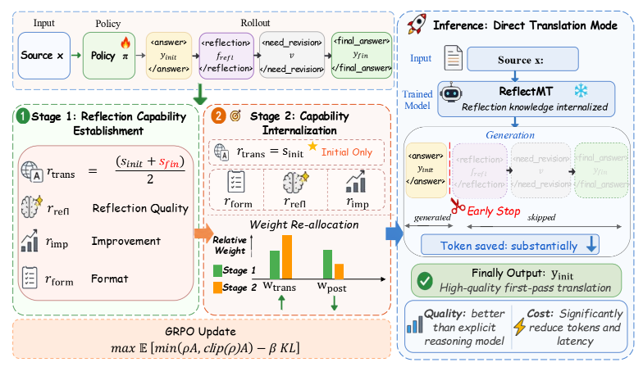

## 🏴 Overview


<p align="center">
  <a href="docs/method.pdf">
    
  </a>
</p>
<p align="center"><em><a href="docs/method.pdf">Overview of ReflectMT (vector PDF)</a></em></p>

ReflectMT is a two-stage reinforcement learning framework for efficient, high-quality machine translation. It first teaches models to translate, reflect, and refine, then internalizes these skills into direct translation, enabling high-quality outputs without explicit reflection at inference time. The framework combines multi-agent reflection data construction with multi-dimensional reward modeling. On WMT24 English-to-Chinese translation, ReflectMT achieves a GPT-4o-based GRF score of 86.16, compared with 84.03 for DeepSeek-R1, while generating approximately 92% fewer output tokens.


## 🏃 Running the Experiments

### 🔌 Step 1: data construction
Enter the relevant prompts and API configurations, then run the data generation code.

```bash
cd data_construction
python qwen-deepseek_agentv3.py
```

After data filtering, convert the data into JSON-formatted SFT training data.

```bash
python our2json_con_multi.py
```

### 🚀 Step 2: SFT

```bash
cd train/SFT/LLaMA-Factory

bash examples/train_lora/qwen2.5_lora_sft.sh
bash examples/merge_lora/merge.sh
```

### 🚀 Step 3: RL Stage 1

```bash
cd train/RL/trans-rl/deepscaler/verl
bash ../scripts/train/run_qwen.sh
```

### 🚀 Step 4: RL Stage 2
Initialize the model from the Stage 1 checkpoint and update the reward configuration according to the Stage 2 objective described in the paper. Use the same training command as in Stage 1, with the checkpoint path and reward configuration updated accordingly.


## 🧠 Evaluation
### GRF score

```bash
cd eval
python GRF.py
```

### Output Token Count

```bash
cd eval
python calcu_token.py
```

### Other metrics
The paper also employs MetricX24 and COMETKIWI-XL as evaluation metrics; please refer to the citations within the text for further details on these evaluations.

## 📖 Citation

Please cite the following if you find ReflectMT helpful:

```
@misc{li2026reflectmtinternalizingreflectionefficient,
      title={ReflectMT: Internalizing Reflection for Efficient and High-Quality Machine Translation}, 
      author={Kunquan Li and Yingxue Zhang and Zhibin Lan and Fandong Meng and Jinsong Su},
      year={2026},
      eprint={2604.19144},
      archivePrefix={arXiv},
      primaryClass={cs.CL},
      url={https://arxiv.org/abs/2604.19144}, 
}
```

